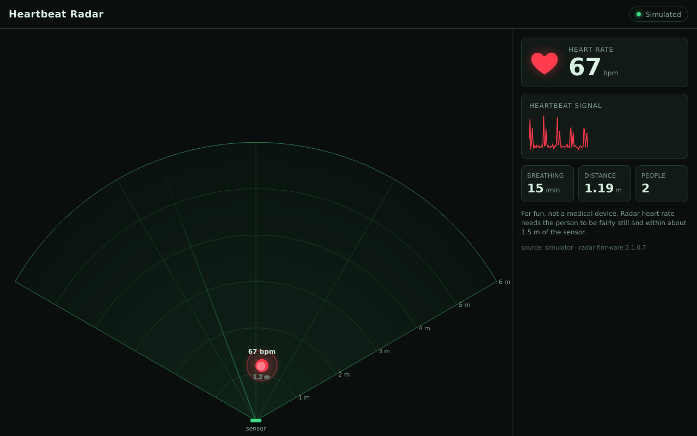

# Positional Pi Heartbeat Sensor

A Raspberry Pi + 60 GHz mmWave radar that shows a **top-down map** of the area in
front of it, with a **red dot for each person that pulses with their heartbeat**,
all without touching anyone. You view it in a web browser on your phone or computer.



## How it works

```
 MR60BHA2 radar ──UART──> XIAO ESP32C6 ──USB──> Raspberry Pi ──Wi-Fi──> your browser
 (heart rate, breathing,   (bridge firmware,     (Python: decode frames,  (live map +
  x/y of up to 3 people)    in this repo)          web server)              pulsing dot)
```

The [Seeed Studio MR60BHA2 kit](https://www.seeedstudio.com/MR60BHA2-60GHz-mmWave-Sensor-Breathing-and-Heartbeat-Module-p-5945.html)
measures heart rate and breathing for one person and tracks the x/y position of
up to 3 people. The Pi decodes its serial protocol, works out which tracked
person the vitals belong to, and streams everything to the browser over a WebSocket.

What to expect from the sensor:

- **Heart rate and breathing:** one person, within about **1.5 m**, sitting or lying fairly still.
- **Position:** up to 3 people, out to about **6 m**.
- Readings take several seconds to settle after someone sits down.

## What you need

| Part | Notes | ~Cost |
|---|---|---|
| Raspberry Pi | 3/4/5 (2 GB is plenty) | — |
| **Seeed MR60BHA2 60 GHz mmWave kit** | Comes with the XIAO ESP32C6 attached | $27 |
| microSD card, 16–32 GB | Separate from your PiKVM card, so you can swap back | $8 |
| USB-A to USB-C **data** cable | Connects the radar kit to the Pi. Some cables are charge-only and won't work | $5 |
| Pi power supply (5 V / 3 A USB-C) | The official one is recommended | — |

This doesn't require any soldering and  GPIO wiring. See [docs/SETUP.md](docs/SETUP.md) for
the full step-by-step guide.

## Quick start: trying a hardware-less demo

The simulator produces real MR60BHA2 frames, so you can see the UI on any computer
before the radar arrives:

```bash
git clone https://github.com/Jecobe/Positional-Pi-Heartbeat-Sensor.git
cd Positional-Pi-Heartbeat-Sensor
python3 -m venv .venv
.venv/bin/pip install .
.venv/bin/heartbeat-radar --source sim
```

Then open <http://localhost:8000>.

## Setup on the Pi (short version)

1. Flash **Raspberry Pi OS Lite (64-bit)** to a new microSD with Raspberry Pi Imager
   (set the hostname, Wi-Fi and SSH in the Imager settings).
2. Flash [`firmware/mr60bha2_usb_bridge`](firmware/mr60bha2_usb_bridge/mr60bha2_usb_bridge.ino)
   to the kit's XIAO ESP32C6 with the Arduino IDE (**USB CDC On Boot: Enabled**).
3. Plug the radar kit into the Pi over USB, then on the Pi run:
   ```bash
   sudo apt-get install -y git
   git clone https://github.com/Jecobe/Positional-Pi-Heartbeat-Sensor.git
   cd Positional-Pi-Heartbeat-Sensor
   ./scripts/install.sh
   ```
4. Open `http://<pi-hostname>.local:8000`.

Full details and troubleshooting are in [docs/SETUP.md](docs/SETUP.md).

## Options

```
heartbeat-radar serve [--source mr60bha2|sim] [--port auto|/dev/ttyACM0]
                      [--host 0.0.0.0] [--http-port 8000]
                      [--max-range 6] [--fov 120]
                      [--swap-xy] [--flip-x] [--flip-y]
heartbeat-radar dump  [--port auto] [--raw]     # print decoded radar frames
```

When it runs as a service, put options in `/etc/default/heartbeat-radar`, then
run `sudo systemctl restart heartbeat-radar`.

If people show up on the wrong side of the map, add `--flip-x`. If moving toward
the sensor moves the dot sideways, add `--swap-xy`.

## Project layout

```
heartbeat_radar/
  sources/mr60bha2.py       MR60BHA2 frame parser and decoder
  sources/serial_source.py  reads the radar over USB serial and reconnects on unplug
  sources/simulator.py      fake radar for development
  state.py                  latest readings, staleness, which person has the vitals
  server.py                 FastAPI app: static UI + /ws WebSocket + /api/state
  static/                   the web UI (no build step, no internet needed)
firmware/                   XIAO ESP32C6 USB bridge sketch
scripts/install.sh          Pi installer and systemd service
docs/                       setup guide and protocol notes
```

Adding a different radar means writing a new source that emits the events in
`heartbeat_radar/events.py`. Nothing else has to change.

## Development

```bash
.venv/bin/pip install -e '.[dev]'
.venv/bin/pytest
```

## Credits and license

The serial protocol is based on Seeed Studio's MIT-licensed
[Seeed-mmWave-library](https://github.com/Love4yzp/Seeed-mmWave-library).
This project is released under the [MIT License](LICENSE).
